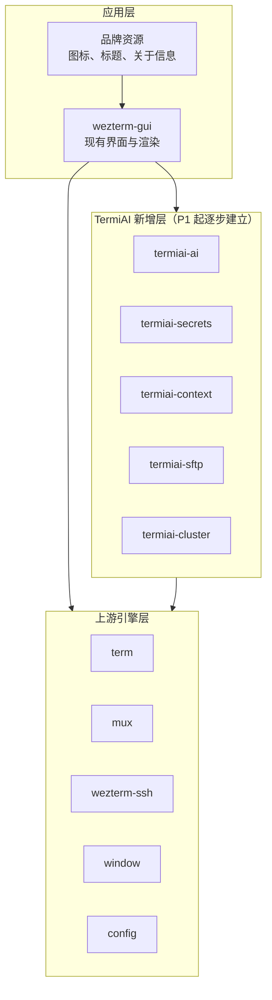

# P0 工程基线与 WinUI 3 技术验证

- 状态：未开始
- 依赖：无
- 需求来源：PRD 第一部分第 2 节（WinUI 3 视觉）、第二部分第 1 节（设置入口）、目标平台说明

## 1. 阶段目标

P0 不实现任何用户可见的 AI 功能。它要解决的是“后续每一阶段都能稳定开发、持续合并上游”的问题，同时用可测量的验证结果决定 WinUI 3 是否按 PRD 的设想落地。

阶段结束时应当具备：

- 在干净的 Windows 10 / 11 机器上按文档完成构建，CI 对每次提交执行格式检查、编译、测试与 GUI 构建。
- 明确的模块边界与上游修改规则，后续阶段不再临时决定代码放哪。
- 统一的配置命名空间、密钥存放位置与日志脱敏规则。
- WinUI 3 宿主方案的验证报告，给出继续、调整或降级的具体结论。

## 2. 范围

本阶段包含：

- Windows 构建流程与 CI。
- 品牌化方案与最小实现：窗口标题、图标、关于信息、安装包命名规则。
- 配置、密钥、日志、错误处理的跨阶段约定。
- 上游同步策略与目录边界。
- WinUI 3 技术验证。

本阶段不包含：

- AI 服务接入、设置面板、Copilot 面板。
- 内置 SFTP 界面。
- 正式的 WinUI 3 代码迁移。
- 安装包签名与自动更新通道。

## 3. 工程设计

### 3.1 工程结构

P0 结束后，仓库形成三层结构：

应用层负责界面与交互，TermiAI 新增层承载新能力，上游引擎层保持原有职责。新增层只能通过公开接口调用引擎层，不能让引擎层反向依赖新增层，否则合并上游时会出现循环依赖。

### 3.2 Windows 构建与 CI

现有仓库已经有 Windows 构建工作流，但它们服务于上游的多平台发布。TermiAI 需要一个独立的、面向本项目的检查流程：

- 格式检查：`cargo fmt --all --check`。
- 编译检查：`cargo check --workspace`。
- 单元测试：`cargo test --all`。
- GUI 构建：`cargo build --release --bin wezterm-gui`。
- 构建耗时记录：CI 输出各步骤耗时，便于发现依赖膨胀。[工程判断]

新增工作流放在 `.github/workflows/` 下，不改动上游已有的发布工作流。CI 只跑 Windows，Linux 与 macOS 不纳入本项目验收。

Windows 构建依赖 Rust MSVC 工具链、Visual Studio Build Tools 与 Strawberry Perl，具体步骤已在 [README.md](../../README.md) 中说明。CI 需要固定这些工具的版本或安装方式，避免上游依赖升级后构建突然失效。[工程判断]

### 3.3 品牌化策略

品牌化分三层推进，P0 只做前两层：

| 层级 | 内容 | P0 是否实施 |
| --- | --- | --- |
| 产品信息 | 窗口标题、关于信息、版本号展示、错误提示中的产品名 | 是 |
| 视觉资源 | 应用图标、任务栏图标、安装包图标 | 是 |
| 可执行文件与安装包 | 二进制名称、快捷方式、MSIX 或 setup 安装包 | P7 及发布阶段 |

不建议在 P0 重命名上游 crate 或二进制。内部名称保持不变，可以减少后续合并上游时的冲突；用户看到的产品名通过窗口标题、快捷方式与安装包控制。[工程判断]

需要确认的事项：配置目录是否从 WezTerm 的路径迁到 `%APPDATA%\TermiAI`。迁移会影响已经使用上游配置的用户，首期可以继续读取原路径，只把 TermiAI 自己的设置放进独立子目录。[待确认]

### 3.4 配置与密钥约定

AI 配置放在 `config.termiai` 命名空间，结构由 `config` crate 的 `Config` 结构体扩展，沿用 `#[derive(ConfigMeta)]` 与 `#[dynamic(...)]` 的注册方式。[工程判断]

密钥不进入 Lua 配置，也不出现在命令行参数中。统一存放在 `%LOCALAPPDATA%\TermiAI\secrets.bin`，由 Windows DPAPI 按当前用户加密。文件格式在 P1 定义，P0 只确定位置与访问规则：

- 文件权限只允许当前用户读取。
- 写入采用临时文件加原子替换，避免断电造成半写文件。
- 读取失败时视为“没有配置密钥”，引导用户重新输入，不尝试猜测或修复密文。

这项约定的依据是 PRD 中“API Key 采用 Windows DPAPI 本地加密存储，绝不上传云端”的要求。[PRD]

### 3.5 日志脱敏

现有日志由 `env-bootstrap` 初始化。P0 增加统一的日志入口约定，后续模块不直接拼接可能包含敏感信息的字符串：

- 禁止记录 API Key、SSH 密码、完整请求体与完整响应体。
- HTTP 日志只保留服务商、模型名、状态码、耗时、token 用量。
- 终端上下文日志只保留行数与来源窗格标识，不保留正文。
- 错误信息进入界面前经过同一层脱敏函数。

这一层放在 `env-bootstrap` 或独立的 `termiai-log` 模块中都可以，P0 需要给出具体位置并写入 ADR。[工程判断]

### 3.6 WinUI 3 技术验证

这是 P0 最关键的部分。现有终端窗口由 `window` crate 的 Win32 后端创建，渲染使用 OpenGL；WinUI 3 使用 Windows App SDK 与 XAML 合成器，两者没有现成的桥接代码。需要先验证三条路线：

| 路线 | 做法 | 优点 | 主要风险 |
| --- | --- | --- | --- |
| A. WinUI 3 外壳 + 子窗口 | WinUI 3 负责窗口边框、标题栏、标签页与设置；终端渲染 Surface 作为子窗口嵌入 | 复用现有渲染器，改动集中在窗口层 | 子窗口与 XAML 合成的层级、裁剪、DPI、输入焦点需要实测 |
| B. SwapChainPanel 渲染后端 | 为 `window` crate 增加 WinUI 3 后端，把终端画面输出到 `SwapChainPanel` | 视觉一体化程度最高，动效与材质容易统一 | 需要重写交换链与输入循环，WGL 与 DXGI 共享表面存在兼容问题 |
| C. 仅设置使用 WinUI 3 | 主窗口保持 Win32，设置、关于、更新等独立窗口使用 WinUI 3 | 风险最低，能快速获得现代设置界面 | 不满足 PRD 对 Mica、无边框圆角主窗口的要求，属于降级方案 |

验证需要产出可比较的数据，而不是只看截图：

| 指标 | 采集方式 | 通过标准 |
| --- | --- | --- |
| 键盘输入到画面反馈的延迟 | 固定按键脚本，录屏逐帧比对，取中位数 | 不高于现有 Win32 窗口的中位数加 16ms |
| 窗口缩放与 DPI 切换 | 100%、150%、200% 缩放各执行一次 | 文字不模糊，终端网格不撕裂 |
| 输入法 | 微软拼音输入中文与候选框定位 | 候选框跟随光标，提交内容正确 |
| 拖拽文件 | 从资源管理器拖入终端 | 触发 `WindowEvent::DroppedFile`，路径正确 |
| Mica 与 Acrylic | Windows 11 开启材质，Windows 10 检查回退 | 无黑底、无闪烁，Win10 有可用替代 |
| 打包与运行 | 未安装 Windows App SDK 的干净机器 | 明确依赖的运行时安装方式，启动不报错 |

验证代码放在独立的 `spikes/winui3/` 目录，不进入主构建。验证结束后保留报告与最小复现工程，删除不会被复用的临时代码。[工程判断]

决策门槛：如果路线 A 或 B 能在上述指标上达到要求，P7 按对应路线推进；如果两者都无法稳定运行，P7 采用路线 C，并在 PRD 层面记录视觉目标的范围调整。这个结论必须在 P0 结束前给出，不能拖到 P7 再决定。

## 4. 任务拆分

| 编号 | 任务 | 产出 |
| --- | --- | --- |
| P0-T01 | 新增 Windows CI 工作流 | 格式、编译、测试、GUI 构建四类检查 |
| P0-T02 | 补齐干净环境构建文档与脚本 | README 构建步骤可复现，依赖版本有记录 |
| P0-T03 | 品牌化最小实现 | 窗口标题、图标、关于信息、版本展示 |
| P0-T04 | 编写 ADR-001 上游同步与模块边界 | 明确新 crate 命名、允许修改的上游文件列表 |
| P0-T05 | 编写 ADR-002 配置与密钥存储 | 命名空间、路径、权限、失败处理 |
| P0-T06 | 日志脱敏入口 | 统一脱敏函数与使用约定 |
| P0-T07 | WinUI 3 三条路线验证 | 验证工程、指标记录、对比报告 |
| P0-T08 | 宿主方案决策记录 | ADR-003，给出 P7 采用路线与降级条件 |

## 5. 验收标准

- 在未安装 Rust 的干净 Windows 11 机器上，按 README 完成构建并启动 GUI。
- CI 在提交与合并请求上执行，格式、编译、测试、GUI 构建全部通过。
- 窗口标题、任务栏名称与关于信息显示 TermiAI，不再出现上游项目作为产品名。
- 任意日志与错误弹窗中不出现测试用 API Key 或 SSH 密码。
- WinUI 3 验证报告包含三条路线的指标对比与明确结论。
- ADR-001 至 ADR-003 完成评审并合并。

## 6. 风险与退出条件

| 风险 | 处理 |
| --- | --- |
| 上游 CI 与新增 CI 重复，维护两套流程 | 新增流程只做本项目检查，发布流程暂不接管；P7 再评估合并 |
| 品牌化改动散落在上游文件里 | 所有显示名称集中到常量或资源文件，禁止在业务代码中硬编码 |
| WinUI 3 验证范围失控 | 验证只做窗口、输入、渲染、材质四类指标，不实现业务界面 |
| 干净机器缺少 Windows App SDK | 验证阶段记录两种分发方式：依赖运行时或自带部署，P7 前给出选择 |

P0 的退出条件是“工程基线可用且宿主路线有结论”。如果 WinUI 3 验证无法在合理范围内完成，可以先以路线 C 关闭 P0，P7 再根据产品优先级重新评估，不阻塞 P1 至 P6。
