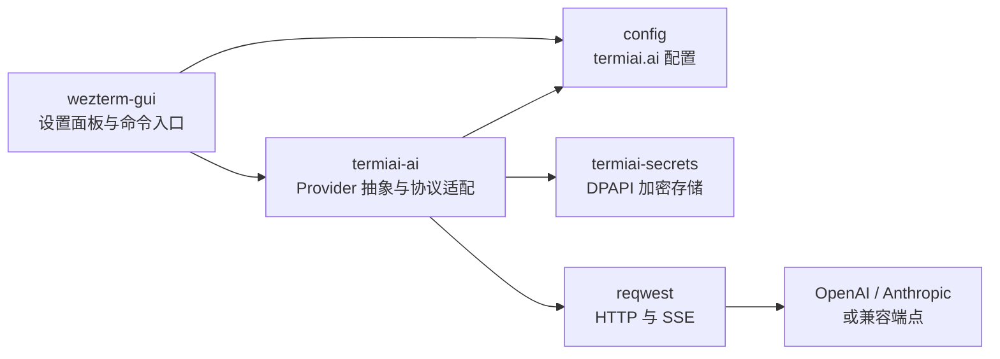
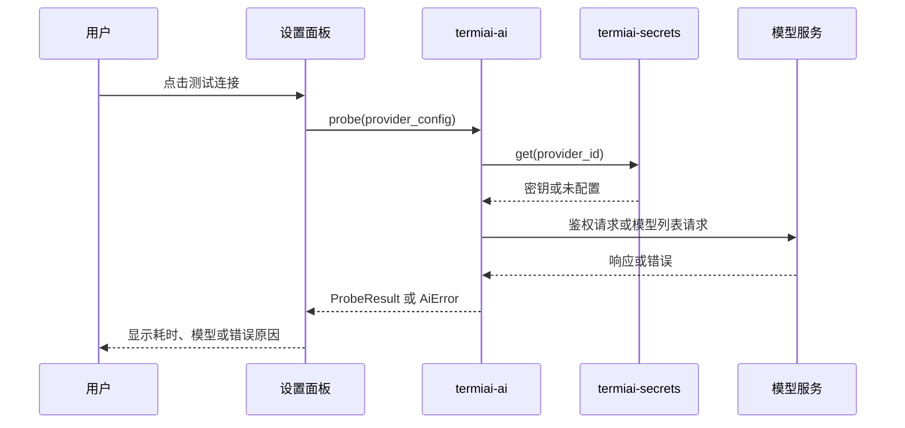

# P1 AI 接入底座

- 状态：未开始
- 依赖：P0
- 需求来源：PRD 第一部分第 1 节（AI 接入与双协议支持）、第二部分第 1 节（AI 配置交互）

## 1. 阶段目标

P1 建立 AI 能力的底座：用户能够配置 OpenAI 与 Anthropic 两类服务，密钥安全落盘，发起一次可取消的流式对话，并在设置界面完成连通性测试。这个阶段不读取终端上下文，也不提供 Copilot 面板；它只保证“AI 服务能稳定连上、错误能说清楚、密钥不会泄露”。

阶段结束时应具备：

- 新增 `termiai-ai` 与 `termiai-secrets` 两个 crate，前者不依赖 GUI，后者不依赖具体服务商。
- `config.termiai.ai` 配置结构可被 Lua 配置写入并通过校验。
- Windows DPAPI 加密的密钥存储，支持新增、替换、删除与读取失败处理。
- 设置面板可切换服务商、编辑参数、测试连通性。
- 统一的流式事件、错误类型与取消机制。

## 2. 范围

本阶段包含：

- OpenAI 兼容接口与 Anthropic 接口的请求封装。
- 流式响应解析、超时、取消与错误映射。
- 配置模型与校验。
- 密钥存储。
- AI 设置面板与命令面板入口。
- 连通性测试与模型探测。

本阶段不包含：

- 终端上下文采集与发送。
- Copilot 对话界面。
- 内联补全、报错诊断、多服务器协同。
- 模型调用计费统计与额度管理。

## 3. 工程设计

### 3.1 模块关系



`termiai-ai` 接收统一格式的请求，根据配置选择协议适配器，把流式响应转换成内部事件。`termiai-secrets` 只返回密钥明文给调用方，不参与请求构造之外的逻辑。`wezterm-gui` 只负责表单与状态展示。[工程判断]

### 3.2 配置模型

配置放在 `config.termiai.ai`。字段设计如下：

| 字段 | 类型 | 默认值 | 说明 |
| --- | --- | --- | --- |
| `active_provider` | 字符串 | 空 | 当前使用的服务商标识，对应 `providers` 的键 |
| `providers` | 映射 | 空 | 键为服务商标识，值为服务商配置 |
| `providers.<id>.protocol` | 枚举 | `openai` | `openai` 或 `anthropic` |
| `providers.<id>.base_url` | 字符串 | 空 | 服务根地址，不带具体路径 |
| `providers.<id>.model` | 字符串 | 空 | 模型名称 |
| `providers.<id>.system_prompt` | 字符串 | 内置运维助手提示 | 该服务商的默认系统提示 |
| `providers.<id>.timeout_seconds` | 整数 | 60 | 单次请求总超时 |
| `providers.<id>.max_output_tokens` | 整数 | 2048 | 单次回答上限，具体上限由服务商决定 |
| `providers.<id>.temperature` | 浮点数 | 0.2 | 生成温度，运维场景默认偏低 |

API Key 不在配置中。密钥以 `provider_id` 为索引单独存储，这样配置可以随项目或配置仓库分享，而密钥留在本机。[工程判断]

Lua 配置示例：

```lua
config.termiai = {
  ai = {
    active_provider = "openai-main",
    providers = {
      ["openai-main"] = {
        protocol = "openai",
        base_url = "https://api.openai.com",
        model = "your-model-name",
        timeout_seconds = 60,
        system_prompt = "你是一名 Linux 运维助手，回答前先说明风险。",
      },
      ["anthropic-main"] = {
        protocol = "anthropic",
        base_url = "https://api.anthropic.com",
        model = "your-model-name",
        timeout_seconds = 90,
      },
    },
  },
}
```

配置校验规则：`active_provider` 必须指向已存在的键；`base_url` 必须是 http 或 https 地址；`timeout_seconds` 允许 5 至 600；`max_output_tokens` 必须大于 0。校验失败时保留用户原始输入并指出具体字段，不回退到默认服务商。[工程判断]

### 3.3 Provider 接口

`termiai-ai` 对外暴露两个稳定接口：一次对话与一次连通性测试。协议差异封装在适配器内部。

```rust
#[async_trait::async_trait]
pub trait ChatProvider: Send + Sync {
    async fn stream_chat(
        &self,
        request: ChatRequest,
        sink: &mut dyn ChatEventSink,
    ) -> Result<ChatUsage, AiError>;

    async fn probe(&self) -> Result<ProbeResult, AiError>;

    fn cancel(&self);
}

pub struct ChatRequest {
    pub model: String,
    pub system_prompt: Option<String>,
    pub messages: Vec<ChatMessage>,
    pub max_output_tokens: u32,
    pub temperature: f32,
    pub timeout: Duration,
}

pub struct ChatMessage {
    pub role: ChatRole,
    pub content: String,
}

pub enum ChatEvent {
    Started,
    Delta(String),
    Finished(ChatUsage),
}
```

`ChatEventSink` 由界面层实现，负责把 `Delta` 追加到面板、把 `Finished` 转成完成状态。适配器不持有 UI 引用，取消通过 `cancel` 或丢弃 sink 实现。[工程判断]

### 3.4 协议适配

OpenAI 协议使用 `POST {base_url}/v1/chat/completions`，请求体包含 `model`、`messages`、`stream: true` 与输出上限。Anthropic 协议使用 `POST {base_url}/v1/messages`，请求头包含 `x-api-key` 与 `anthropic-version`，请求体包含 `system`、`messages`、`max_tokens` 与 `stream: true`。两者的流式响应都是事件流，需要按行解析 `data:` 片段并忽略心跳。[工程判断]

`base_url` 需要先规范化：去掉末尾斜杠；如果用户填入的地址已经以 `/v1` 结尾，则不再重复追加，避免出现 `/v1/v1/chat/completions`。规范化结果在设置面板中回显，用户能直接看到最终请求地址。[工程判断]

Anthropic 的版本头取值随服务端要求变化，具体值在实现时确认并集中到一个常量中，不散落在代码里。[待确认]

`probe` 的行为按服务商能力区分：如果服务端提供模型列表接口，则返回模型列表；如果不提供，则发送一条最小化请求验证鉴权，并返回配置中的模型与往返耗时。PRD 中的“模型列表”在后者情况下只显示当前配置的模型，不伪造列表。[PRD]

流式请求一旦收到第一个有效片段，就不再自动重试，避免重复计费与重复输出。连接建立前的 429 与 5xx 可以重试一次，重试间隔从响应头读取，读不到时使用固定短间隔。[工程判断]

### 3.5 错误模型

| 错误 | 触发条件 | 界面提示 | 是否可重试 |
| --- | --- | --- | --- |
| `Auth` | 401、403 或密钥缺失 | 密钥无效或未配置，引导打开设置 | 否 |
| `InvalidRequest` | 400，模型名或参数不合法 | 显示服务端返回的可读信息 | 否 |
| `RateLimited` | 429 | 显示等待时间（若服务端提供） | 是 |
| `Timeout` | 超过 `timeout_seconds` 或流式空闲超时 | 显示已等待时长，保留已收到内容 | 是 |
| `Network` | DNS、TLS、连接中断 | 显示网络错误类别 | 视情况 |
| `Cancelled` | 用户取消 | 不显示错误，标记为已取消 | 是 |
| `Provider` | 其他服务端错误 | 显示状态码与错误码，不显示完整响应体 | 视情况 |

错误类型集中在 `termiai-ai` 定义，GUI 不直接解析 HTTP 状态码。这样后续新增服务商时不需要改界面判断逻辑。[工程判断]

### 3.6 密钥存储

`termiai-secrets` 提供最小接口：

```rust
pub trait SecretStore {
    fn get(&self, id: &str) -> Result<Option<SecretString>, SecretError>;
    fn set(&self, id: &str, value: &SecretString) -> Result<(), SecretError>;
    fn delete(&self, id: &str) -> Result<(), SecretError>;
    fn list_ids(&self) -> Result<Vec<String>, SecretError>;
}
```

Windows 实现使用 DPAPI 的 `CryptProtectData` 与 `CryptUnprotectData`，作用域为当前用户。文件采用带版本头的二进制格式，包含 magic、版本号、条目数与条目长度，便于后续升级格式而不破坏旧文件。[工程判断]

需要注意的实现细节：

- 密文写入临时文件后原子替换，避免半写。
- 读取到损坏文件时返回 `Corrupted`，界面提示重新录入密钥，不自动删除原文件。
- 删除密钥时同时清理内存中的缓存。
- 内存中的密钥使用尽力清零的封装类型，不承诺对抗具备调试权限的攻击者。[工程判断]

### 3.7 设置界面

P1 的设置界面使用现有 GUI 的模态面板实现，复用命令面板的键盘导航与绘制方式；P7 再迁移到 WinUI 3。入口有两个：

- 命令面板增加“TermiAI: AI 设置”。
- 配置文件仍可直接编辑，设置界面只负责常用字段。

面板包含服务商列表、协议选择、Base URL、模型、超时、系统提示、密钥输入与“测试连接”按钮。密钥输入框只显示掩码，保存后不再回显明文。测试连接显示三类结果：连通成功与耗时、鉴权失败、网络失败。[PRD]

界面状态不写入配置，测试结果在关闭面板后丢弃，避免把临时探测结果当成配置。[工程判断]

### 3.8 连通性测试流程



测试使用与正式请求相同的超时和错误映射，避免“测试通过但实际对话失败”。[工程判断]

## 4. 任务拆分

| 编号 | 任务 | 主要位置 |
| --- | --- | --- |
| P1-T01 | 建立 `termiai-ai` crate 与 workspace 注册 | `Cargo.toml`、`termiai-ai/` |
| P1-T02 | 实现配置结构与校验 | `config/src/config.rs`、`config/src/lua.rs` |
| P1-T03 | 建立 `termiai-secrets` 与 DPAPI 实现 | `termiai-secrets/` |
| P1-T04 | OpenAI 兼容适配器与 SSE 解析 | `termiai-ai/src/openai.rs` |
| P1-T05 | Anthropic 适配器与 SSE 解析 | `termiai-ai/src/anthropic.rs` |
| P1-T06 | 统一错误映射、超时与取消 | `termiai-ai/src/error.rs` |
| P1-T07 | 设置模态面板与命令入口 | `wezterm-gui/src/overlay/`、`wezterm-gui/src/commands.rs` |
| P1-T08 | 密钥录入、替换、删除流程 | 设置面板与 `termiai-secrets` |
| P1-T09 | 使用本地模拟服务覆盖协议测试 | `termiai-ai/tests/` |

## 5. 安全与隐私要求

- 密钥只存在于密钥文件与内存，禁止写入 Lua 配置、日志、崩溃转储说明或错误提示。
- 请求使用系统 TLS 校验，不提供“忽略证书错误”的开关。
- 日志只记录协议类型、模型、耗时、状态码与 token 用量。
- 测试连接也会消耗服务商额度，界面在按钮旁说明这一点。[PRD] 成本提示
- 删除服务商配置时，同时提示是否删除对应密钥，默认不删除，避免误操作导致无法恢复。[工程判断]

## 6. 验收标准

- 配置两个不同协议的服务商后，可分别完成一次流式对话，界面逐字显示内容。
- 密钥文件用文本编辑器打开时看不到可读的 Key；删除密钥后再次发起请求返回 `Auth`。
- 错误密钥、错误模型、不可达地址分别显示对应错误类型，不显示完整响应体。
- 请求过程中点击取消，界面在 1 秒内停止追加内容，后台连接关闭。
- 超过 `timeout_seconds` 后返回超时提示，已收到的内容保留。
- 测试连接返回耗时；服务端支持模型列表时显示列表，否则显示当前配置模型。
- 在日志与错误弹窗中搜索测试密钥，结果为空。
- 关闭并重启应用后，配置与密钥仍然可用，设置面板不回显密钥明文。

## 7. 风险与应对

| 风险 | 应对 |
| --- | --- |
| 不同兼容端点的流式格式存在差异 | 解析器只依赖标准事件字段，遇到未知字段忽略并记录一次调试日志 |
| Anthropic 版本头或模型接口变化 | 版本头集中定义，`probe` 对无模型列表的服务端做降级 |
| DPAPI 在服务账户或特殊运行方式下不可用 | 返回明确错误并提示改用用户账户运行，不静默降级到明文 |
| 设置面板与 P7 的 WinUI 3 重复开发 | P1 面板只做必要字段，把业务状态留在 `termiai-ai`，P7 只替换视图层 |
| 配置结构变动影响上游配置解析 | 新增字段全部可缺省，缺省时 AI 功能视为未配置，不影响终端启动 |
