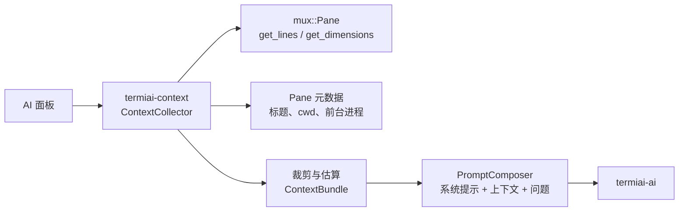
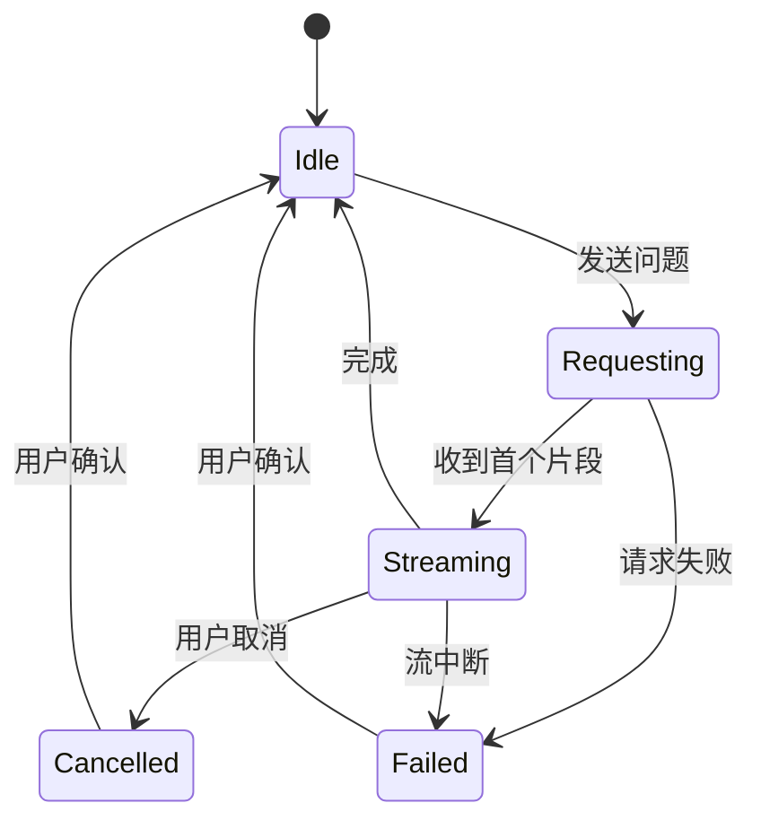
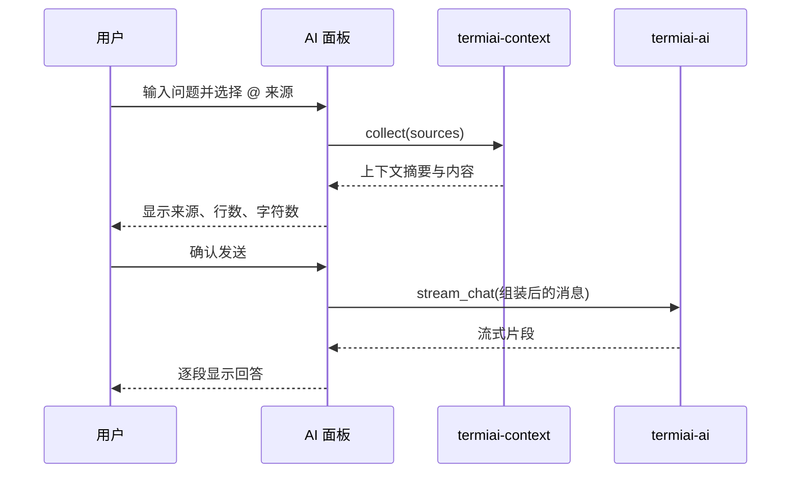

# P2 Copilot 侧边栏与单会话上下文

- 状态：未开始
- 依赖：P1
- 需求来源：PRD 第二部分第 2 节形态 C（AI Copilot Sidebar）、第一部分第 3 节（多会话上下文池的前置能力）

## 1. 阶段目标

P2 让 AI 看见用户指定的终端会话，并在一个常驻面板里完成多轮对话。它是后续报错诊断与多服务器协同的基础：上下文采集、消息组装、流式展示、取消与会话状态都在这阶段定型。

阶段结束时应具备：

- 可呼出的 AI 面板，支持多轮对话、流式输出与取消。
- 通过 `@` 选择一个或多个窗格作为上下文来源。
- 发送前可见的上下文范围与体积提示。
- 上下文裁剪规则，避免把整段滚动缓冲区直接发给模型。

## 2. 范围

本阶段包含：

- 单会话、单窗口内的上下文采集。
- `@` 会话选择器与上下文来源管理。
- AI 面板的多轮对话与流式显示。
- 上下文体积估算与裁剪。
- 面板的键盘操作与命令面板入口。

本阶段不包含：

- 自动捕获报错并发起诊断。
- 多服务器批量执行。
- 浮动抽屉动画与 Mica 材质，这些属于 P7。
- 跨应用重启保存对话历史。

## 3. 工程设计

### 3.1 面板形态

现有 GUI 的窗格系统支持在标签页内分屏，也支持用 `TermWizTerminalPane` 承载基于文本的交互界面。P2 采用“右侧分屏窗格”承载 AI 面板，复用 `wezterm-gui/src/overlay/` 与 `mux/src/termwiztermtab.rs` 的现有机制。[工程判断]

这样做的好处是不用改动渲染布局就能得到常驻面板；代价是面板外观与 PRD 中的“浮动抽屉”还有差距。P7 接入 WinUI 3 后再改为浮动面板与滑入动效，P2 只保证信息结构与交互流程正确。

面板占据当前标签页右侧约三分之一宽度，可通过命令或快捷键切换显示。关闭面板后终端恢复原宽度，窗格内容不丢失。[工程判断]

### 3.2 上下文采集



`termiai-context` 只读取已经存在的窗格状态，不向终端注入任何内容。它通过 `Pane::get_lines` 读取指定行范围，通过 `get_dimensions` 判断可视区域与滚动缓冲区，通过 `get_current_working_dir` 与 `get_foreground_process_name` 获取元数据。[工程判断]

上下文来源分为三类：

| 来源 | 获取方式 | 默认是否包含 |
| --- | --- | --- |
| 当前活动窗格 | 焦点所在 `Pane` | 是 |
| 用户 `@` 的窗格 | 选择器返回的 `PaneRef` | 否，需显式选择 |
| 用户选中的终端文本 | 现有选择范围 | 否，需显式引用 |

默认只带当前活动窗格的末尾若干行，不自动加入同标签页的其他窗格。这样可以避免一次提问把整个工作区的输出都发出去。[PRD] 上下文范围应可控

每个来源的结构：

```rust
pub struct PaneContext {
    pub pane_id: PaneId,
    pub tab_id: TabId,
    pub window_id: WindowId,
    pub label: String,
    pub cwd: Option<String>,
    pub foreground_process: Option<String>,
    pub is_alt_screen: bool,
    pub lines: Vec<String>,
    pub truncated: bool,
}
```

`is_alt_screen` 用于标记全屏程序。处于备用屏幕时，采集到的内容通常是编辑器或分页器界面，默认不加入上下文，除非用户显式选择。[工程判断]

### 3.3 裁剪与体积估算

配置项放在 `config.termiai.context`：

| 字段 | 默认值 | 说明 |
| --- | --- | --- |
| `max_lines_per_pane` | 120 | 单个来源最多采集的行数 |
| `max_total_chars` | 24000 | 所有来源合计字符上限 |
| `include_alt_screen` | false | 是否允许采集备用屏幕内容 |
| `show_preview` | true | 发送前是否显示上下文预览 |

裁剪从最早的行开始丢弃，保留靠近光标的内容。多来源时按来源轮流保留，避免第一个来源占满额度。字符数只是近似指标，不承诺与模型 token 计数完全一致；界面显示“约多少字符”，不显示伪造的 token 数。[工程判断]

发送前在面板顶部显示来源列表与合计行数，例如“当前窗格 120 行，@web-server-01 80 行”。用户可以在发送前移除某个来源。[PRD] 上下文可控

### 3.4 对话消息组装

`PromptComposer` 把一次请求组装成三段：

1. 系统提示：来自 P1 中当前服务商的配置。
2. 上下文块：每个来源带标题、cwd、前台进程与内容，块之间用明确分隔标记。
3. 用户问题：面板输入框中的原始文本。

上下文块使用稳定的文本格式，便于模型区分来源，也便于调试时复现：

```text
[context source="pane:42" label="web-server-01" cwd="/srv/app"]
...终端内容...
[/context]
```

不在上下文块中插入模型无法识别的二进制控制字符；终端文本转换为纯文本后发送，ANSI 转义序列在采集阶段剥离。[工程判断]

### 3.5 面板会话状态



一个面板对应一个内存中的会话，保存消息列表、当前上下文来源与最近一次请求状态。关闭面板不立即清空会话；关闭标签页或退出应用时清空。历史记录暂不落盘，避免在没有隐私设计的情况下保存终端内容。[工程判断]

用户可以在会话中更换 `@` 来源，新的请求使用新的来源集合，旧消息保持不变。界面需要标记每条回答使用的是哪一组来源，便于回溯。[工程判断]

### 3.6 面板交互

| 操作 | 行为 |
| --- | --- |
| `Ctrl+Space` | 显示或隐藏 AI 面板 |
| 输入 `@` | 打开窗格选择器，支持按标题、cwd、前台进程过滤 |
| `Enter` | 发送当前输入，输入框内换行使用 `Shift+Enter` |
| `Esc` | 取消正在生成的回答；空闲时关闭选择器 |
| `Ctrl+L` | 清空当前会话消息，不删除配置 |
| 上箭头 | 调出上一条用户输入 |

面板显示的消息采用纯文本加代码块样式。命令、文件名与路径使用等宽字体；不在 P2 渲染富文本卡片。P3 需要的建议命令以编号列表呈现，P7 再改为卡片。[工程判断]

### 3.7 发送与隐私流程



发送动作必须由用户触发。切换 `@` 来源、打开面板、窗格输出变化都不会自动发起请求。面板在首次发送前展示完整预览；同一会话后续发送只显示摘要，用户仍可展开查看。[PRD] AI 无侵入介入

## 4. 任务拆分

| 编号 | 任务 | 主要位置 |
| --- | --- | --- |
| P2-T01 | 建立 `termiai-context` crate 与数据模型 | `termiai-context/` |
| P2-T02 | 实现窗格文本采集与元数据读取 | `termiai-context/src/pane.rs` |
| P2-T03 | 实现裁剪、字符估算与来源标记 | `termiai-context/src/budget.rs` |
| P2-T04 | 实现消息组装与上下文格式 | `termiai-context/src/prompt.rs` |
| P2-T05 | 建立右侧 AI 面板窗格 | `wezterm-gui/src/termiai/panel.rs` |
| P2-T06 | 实现 `@` 窗格选择器 | `wezterm-gui/src/termiai/picker.rs` |
| P2-T07 | 接入流式事件、取消与错误显示 | `wezterm-gui/src/termiai/panel.rs` |
| P2-T08 | 增加命令面板入口与快捷键 | `wezterm-gui/src/commands.rs`、`inputmap.rs` |
| P2-T09 | 面板会话状态与来源快照 | `wezterm-gui/src/termiai/session.rs` |
| P2-T10 | 使用模拟窗格与模拟模型服务做测试 | `termiai-context/tests/` |

## 5. 验收标准

- 按 `Ctrl+Space` 在 300 毫秒内显示面板，终端输出不中断。
- `@` 选择器列出当前窗口所有窗格，按标题与 cwd 过滤有效；选中后来源出现在面板顶部。
- 发送前能看到来源列表、合计行数与约字符数；移除来源后数字同步变化。
- 一次请求可以流式显示回答，取消后 1 秒内停止追加，后台连接关闭。
- 面板默认只带当前活动窗格，未 `@` 的其他窗格内容不出现在请求中。
- 处于备用屏幕的窗格默认不采集；显式选择时界面提示内容可能包含界面元素而非命令输出。
- 关闭面板再打开，当前会话消息仍在；关闭标签页后会话释放。
- 未配置 AI 服务时，打开面板显示配置引导，不发起任何网络请求。

## 6. 风险与应对

| 风险 | 应对 |
| --- | --- |
| 终端文本包含宽字符、组合字符或超链接，简单拼接会错位 | 采集阶段按行调用现有文本转换逻辑，必要时补充测试用例 |
| 字符估算与模型 token 上限不一致导致请求被拒 | 界面显示“约字符数”，请求失败时提示减少来源或行数 |
| 面板作为分屏窗格改变原有布局 | 提供开关与恢复命令，关闭后恢复原尺寸；布局变更不影响正在运行的进程 |
| 窗格在采集过程中被关闭 | 采集返回“来源不可用”，跳过该来源并在面板标记 |
| 用户误把敏感输出发往第三方 | 默认只带活动窗格，发送前展示预览，备用屏幕默认排除 |
