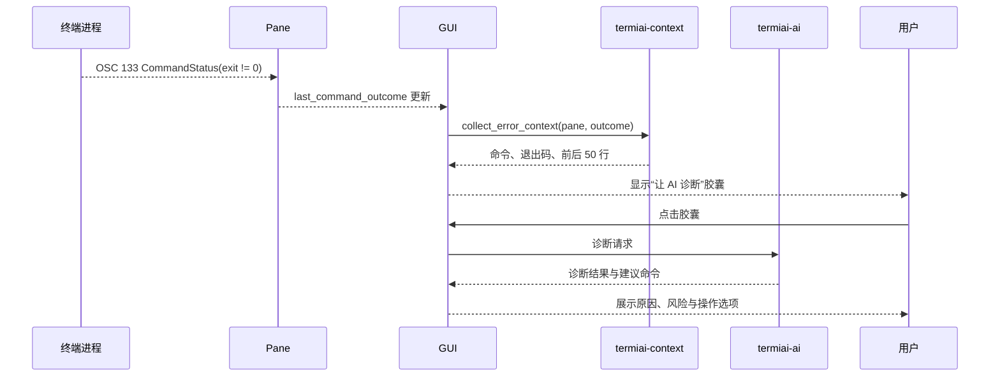

# P3 智能报错捕获与安全确认

- 状态：未开始
- 依赖：P1、P2
- 需求来源：PRD 第二部分第 2 节形态 B（Smart Debugger）、第一部分第 3 节（安全沙箱与二次确认）

## 1. 阶段目标

P3 把“命令执行失败”变成一次可控的 AI 诊断：终端能判断上一条命令是否以非零状态结束，自动收集报错上下文，在界面上提供“让 AI 诊断”的入口；AI 给出的修复命令必须经过风险判定与人工确认才能执行。

阶段结束时应具备：

- 可靠的非零退出码采集，且只在 shell 集成可用的会话中启用。
- 报错上下文捕获：命令文本、退出码、报错输出前后若干行。
- 错误胶囊入口与诊断结果展示。
- 修复命令的风险分级、确认卡片与执行结果回显。

## 2. 范围

本阶段包含：

- OSC 133 命令状态与命令文本的采集。
- 退出码到 GUI 的事件通道。
- 报错上下文捕获与裁剪。
- 诊断请求、结构化结果解析与展示。
- 高危命令判定、确认与执行。

本阶段不包含：

- 多服务器批量执行。
- 自动修复，即未确认就执行命令。
- 内联补全。
- 对 AI 回答的自动采纳。

## 3. 工程设计

### 3.1 退出码采集

终端的语义提示解析已经能识别 OSC 133 的 `CommandStatus`，但当前实现直接忽略该事件；相关位置在 `term/src/terminalstate/performer.rs`。[工程判断]

P3 需要在终端模型层增加一份“最近一次命令结果”：

```rust
pub struct CommandOutcome {
    pub sequence: u64,
    pub command_text: Option<String>,
    pub exit_code: Option<i32>,
    pub output_start: Option<StableRowIndex>,
    pub output_end: Option<StableRowIndex>,
    pub finished_at: Option<SystemTime>,
}
```

采集规则：

- 在 `MarkEndOfPromptAndStartOfInput` 时记录输入区域起点，在 `MarkEndOfInputAndStartOfOutput` 时把输入区域文本保存为命令文本。
- 收到 `CommandStatus` 时写入退出码与结束时间，`sequence` 自增。
- 输出范围从 `MarkEndOfInputAndStartOfOutput` 到下一次提示开始之间确定。
- 没有 shell 集成时，这些字段保持为空，功能不触发。[PRD] 不支持时宁可不用，也不猜测

`Pane` 接口增加一个带默认实现的读取方法，避免影响现有窗格实现：

```rust
pub trait Pane {
    fn last_command_outcome(&self) -> Option<CommandOutcome> {
        None
    }
}
```

本地窗格、SSH 窗格与测试窗格按需覆盖。GUI 通过比较 `sequence` 判断是否出现新结果，避免重复弹出胶囊。[工程判断]

### 3.2 触发流程



胶囊只在满足全部条件时出现：有 shell 集成、退出码非零、窗格不在备用屏幕、用户没有关闭该功能。退出码为零、用户手动中断、终端处于全屏程序时不出现。[工程判断]

### 3.3 报错上下文

`collect_error_context` 复用 P2 的采集器，但参数更严格：

| 内容 | 规则 |
| --- | --- |
| 命令文本 | 来自 OSC 133 输入区域，最多 2000 字符 |
| 退出码 | 原始整数 |
| 报错输出 | 输出区域末尾 50 行，用户可配置为 20 至 200 行 |
| 命令之前的输出 | 默认不采集；用户点击“包含更多上下文”后再取 20 行 |
| cwd 与 shell | 来自窗格元数据 |
| 备用屏幕内容 | 不采集 |

发送前在诊断面板显示将发送的内容摘要。首次使用需要用户确认一次；之后每次诊断仍需点击胶囊，不会自动请求。[PRD] 自动截取上下文并给出诊断，但由用户触发

### 3.4 诊断结果格式

模型返回的内容需要同时包含解释与命令，才能显示为可操作的结果。采用结构化输出加容错解析：

```json
{
  "diagnosis": "简短原因说明",
  "evidence": ["报错中的关键行"],
  "commands": [
    {
      "command": "systemctl restart nginx",
      "purpose": "重启服务使配置生效",
      "risk": "medium"
    }
  ],
  "confidence": "high"
}
```

解析流程：

1. 提示模型只返回 JSON，并给出字段说明。
2. 解析失败时，把原始回答以文本展示，并提供“复制回答”操作，不生成可执行按钮。
3. `commands` 中的命令逐条通过本地风险判定，最终风险取本地判定与模型标记中更严格的一方。
4. 命令文本长度超过 2000 字符或包含不可见控制字符时，不提供执行入口。[工程判断]

不依赖模型自带的风险标记作为唯一依据。模型可能低估风险，本地规则是执行前的最后一道判断。[PRD] 防止 AI 幻觉造成生产事故

### 3.5 风险分级与确认

本地规则分为三档：

| 等级 | 示例 | 界面行为 |
| --- | --- | --- |
| `low` | 只读查看、`systemctl status`、`ls`、`df` | 提供“执行”和“复制” |
| `medium` | 重启服务、修改文件权限、安装软件包 | 弹出确认卡片，说明影响范围 |
| `high` | `rm -rf`、磁盘格式化、删除数据库、关机、覆盖系统配置 | 弹出确认卡片，需勾选“我理解风险”后才能执行；默认只提供复制 |

规则匹配采用命令文本归一化后的模式列表，覆盖常见破坏性操作；未命中规则但包含 `sudo`、重定向到系统路径、管道到 shell 等情况时提升为 `medium`。[工程判断]

确认卡片复用现有 `wezterm-gui/src/overlay/confirm.rs` 的模态机制，显示完整命令、风险等级、AI 给出的目的说明与取消按钮。卡片打开时不拦截终端输出，但键盘焦点在卡片上，防止误输入。[工程判断]

### 3.6 执行与结果回显

执行只通过当前窗格的写入接口发送命令文本与换行，不经过 shell 字符串拼接。执行前记录当前 `sequence`，执行后等待新的 `CommandOutcome`：

- 如果新结果的退出码为零，显示“执行完成”。
- 如果非零，显示新的退出码，并允许再次诊断，但同一命令连续失败三次后停止自动提供入口，避免循环。[工程判断]
- 如果 30 秒内没有收到新的结果，提示“未检测到命令结束”，保留手动检查入口。[工程判断]

执行记录写入本地审计日志，包含时间、窗格标识、命令、风险等级与退出码，不包含命令输出正文。审计日志用于排查误操作，不上传。[PRD] 安全沙箱要求

## 4. 任务拆分

| 编号 | 任务 | 主要位置 |
| --- | --- | --- |
| P3-T01 | 在终端模型记录命令文本、退出码与输出范围 | `term/src/terminalstate/` |
| P3-T02 | 在 `Pane` 暴露最近命令结果 | `mux/src/pane.rs`、`mux/src/localpane.rs`、`mux/src/ssh.rs` |
| P3-T03 | GUI 检测新结果并触发胶囊 | `wezterm-gui/src/termiai/error_watch.rs` |
| P3-T04 | 报错上下文采集 | `termiai-context/src/error.rs` |
| P3-T05 | 诊断提示词与结构化解析 | `termiai-ai/src/diagnose.rs` |
| P3-T06 | 风险规则与归一化 | `termiai-ai/src/risk.rs` |
| P3-T07 | 确认卡片与执行入口 | `wezterm-gui/src/termiai/confirm.rs` |
| P3-T08 | 执行结果跟踪与审计日志 | `wezterm-gui/src/termiai/execute.rs` |
| P3-T09 | shell 集成夹具与端到端测试 | `term/src/test/`、集成测试目录 |
| P3-T10 | 胶囊绘制与键位入口 | `wezterm-gui/src/termwindow/render/pane.rs`、`inputmap.rs` |

## 5. 验收标准

- 在启用 shell 集成的 PowerShell、bash、zsh 中执行失败命令，胶囊在命令结束后 1 秒内出现。
- 胶囊出现时，诊断上下文包含正确命令文本、退出码与末尾 50 行；修改配置后行数随之变化。
- 退出码为零、用户按 `Ctrl+C` 中断、进入 `vim` 等备用屏幕程序时不出现胶囊。
- 高风险命令在确认卡片中出现，未确认前不发送到终端；取消后终端状态不变。
- AI 返回非 JSON 内容时显示原始文本，不生成执行按钮。
- 同一失败命令连续执行三次后不再自动提供诊断入口。
- 审计日志包含命令与退出码，不包含终端输出正文与密钥。
- 关闭 AI 功能后，胶囊与所有诊断入口消失，终端行为回到上游默认。

## 6. 风险与应对

| 风险 | 应对 |
| --- | --- |
| shell 集成未启用，功能在部分用户环境中不可用 | 在设置与胶囊位置提供启用说明；无集成时明确显示不可用，不回退到输出关键词猜测 |
| OSC 133 命令文本采集受多行输入、历史命令影响 | 用输入区域标记为准，补充多行与粘贴场景测试 |
| 模型给出看似安全但实际危险的命令 | 本地规则优先，高危默认只复制；执行前展示完整命令 |
| 诊断请求泄露敏感输出 | 发送前显示摘录与行数；支持排除来源；不自动后台发送 |
| 执行后 30 秒无结果导致误判 | 显示“未检测到结束”，允许手动刷新状态，不重复发送命令 |
