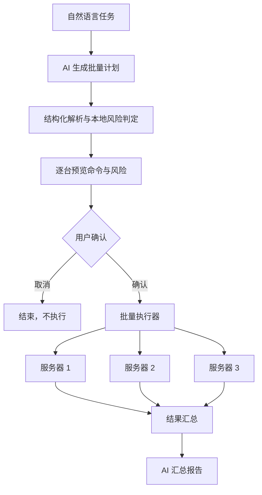
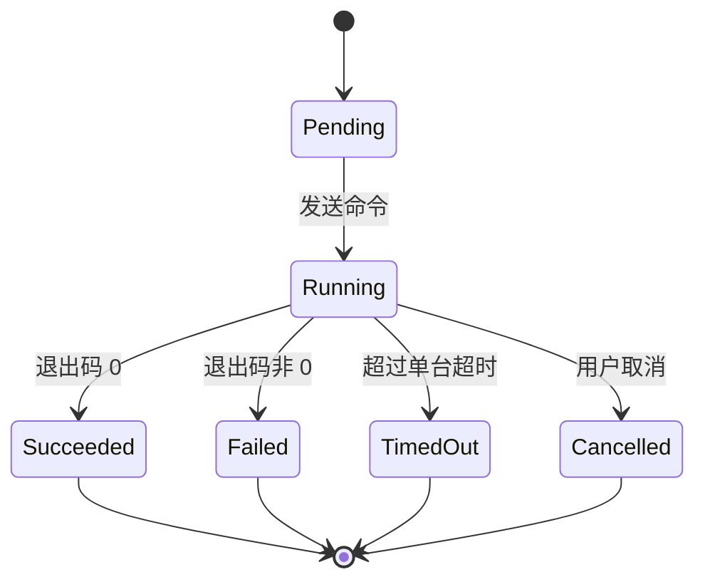

# P4 多服务器集群协同

- 状态：未开始
- 依赖：P2、P3
- 需求来源：PRD 第一部分第 3 节（多远程服务器跨实例 AI 协同）

## 1. 阶段目标

P4 把多个已经建立的终端会话组织成“服务器集群组”，让用户用一句自然语言描述任务，由 AI 生成逐台服务器的执行计划，在用户确认后批量执行，并把各台结果汇总成一份可读的报告。

阶段结束时应具备：

- 集群组的创建、编辑与持久化。
- 批量任务的计划、预览、确认与执行。
- 每台服务器的独立状态、输出摘录与失败处理。
- 高危命令在批量场景下的强制确认。

## 2. 范围

本阶段包含：

- 集群组数据模型与本地持久化。
- 从现有窗格创建集群组。
- AI 生成批量计划与结构化解析。
- 串行执行、可选受限并发、取消与超时。
- 逐台结果采集与汇总报告。
- 批量执行审计。

本阶段不包含：

- 自动创建 SSH 连接或自动发现服务器。
- 跨设备同步集群组。
- 无人工确认的自动修复。
- 与 SFTP 的批量文件分发，后者在 P5 之后单独评估。

## 3. 工程设计

### 3.1 数据模型

集群组只保存窗格引用与展示信息，不保存密码、密钥或连接参数。连接仍由现有 SSH 域配置负责。

```rust
pub struct ClusterGroup {
    pub id: String,
    pub name: String,
    pub members: Vec<ClusterMember>,
    pub created_at: i64,
    pub updated_at: i64,
}

pub struct ClusterMember {
    pub pane_id: PaneId,
    pub tab_id: TabId,
    pub window_id: WindowId,
    pub label: String,
    pub host_hint: Option<String>,
}

pub struct BatchPlan {
    pub request: String,
    pub mode: BatchMode,
    pub steps: Vec<BatchStep>,
}

pub struct BatchStep {
    pub member_id: String,
    pub command: String,
    pub purpose: String,
    pub risk: RiskLevel,
    pub read_only: bool,
}

pub struct BatchResult {
    pub member_id: String,
    pub status: StepStatus,
    pub exit_code: Option<i32>,
    pub output_excerpt: String,
    pub duration_ms: u64,
}
```

`pane_id` 在一次应用运行内有效。应用重启后，集群组仍可显示，但成员标记为“不可用”，直到用户重新绑定窗格。[工程判断]

持久化文件放在 `%APPDATA%\TermiAI\clusters.json`，只包含组名、成员标签与窗格标识，不包含终端内容与凭据。写入采用临时文件加原子替换。[工程判断]

### 3.2 执行模型



默认串行执行，一台结束后再执行下一台。这样输出采集边界清晰，失败时也容易判断影响范围。并发执行作为可选项，上限默认 2，且仅在全部步骤标记为只读时允许开启。[工程判断]

批量执行分两种模式：

| 模式 | 判定依据 | 失败行为 |
| --- | --- | --- |
| 只读巡检 | 所有步骤 `read_only` 为真，且本地风险为 `low` | 某台失败后继续执行其余服务器，便于一次性收集问题 |
| 变更操作 | 存在非只读步骤或 `medium` 以上风险 | 某台失败后默认停止后续步骤，避免在半完成状态下扩大影响 |

模式由本地判定决定，AI 的 `read_only` 标记只作为参考。任一条件不满足就按更严格的模式处理。[PRD] 防止 AI 幻觉造成生产事故

### 3.3 计划生成与解析

计划请求包含：

- 用户的任务描述。
- 每个成员的标签、cwd、前台进程与最近一次命令结果。
- 每台服务器允许采集的末尾若干行输出，默认 40 行。
- 输出格式要求：JSON，包含 `steps` 数组，每项含 `member_id`、`command`、`purpose`、`read_only`。

解析规则与 P3 一致：结构化解析失败时展示原始回答，不执行任何命令；命令逐条经过本地风险规则；成员标识无法匹配时整条计划作废，不做模糊匹配。[工程判断]

计划预览表格包含：服务器标签、命令、目的、风险、是否只读。用户可以删除单条步骤或整体取消。删除步骤不需要重新请求 AI。[工程判断]

### 3.4 执行与输出采集

执行器为每个成员维护独立状态机：



执行前后通过 `CommandOutcome.sequence` 确认结果归属。单台超时默认 120 秒，可配置为 30 至 600 秒；超时后不自动发送中断信号，界面提供“发送 Ctrl+C”按钮，由用户决定。[工程判断]

输出摘录按 P3 的输出范围采集，最多 80 行；汇总报告只带摘录，不把全部输出再次发给模型。需要深入分析某台时，用户可以单独打开该会话继续追问。[工程判断]

### 3.5 高危命令处理

批量预览阶段，任何 `high` 风险步骤都单独列出并要求逐条确认。确认卡片显示命令、目标服务器与影响说明；未确认的步骤不会进入执行队列。[PRD] 强制二次人工确认

如果计划中包含 `sudo`、数据库写入、服务重启等变更操作，预览页顶部显示“本次包含变更操作”的固定提示，不能通过一次点击跳过。[工程判断]

### 3.6 汇总报告

全部步骤结束后，执行器生成结构化结果，再请求 AI 汇总：

- 每台服务器的状态、退出码、耗时。
- 失败项的共同点与差异点。
- 建议的下一步，只作为文本建议，不生成批量执行按钮。

汇总报告在面板中显示，并支持导出为 Markdown 文件。导出内容包含命令与输出摘录，用户需要确认后再保存。[工程判断]

## 4. 任务拆分

| 编号 | 任务 | 主要位置 |
| --- | --- | --- |
| P4-T01 | 集群组模型与持久化 | `termiai-cluster/src/group.rs` |
| P4-T02 | 从窗格创建与编辑集群组 | `wezterm-gui/src/termiai/cluster_ui.rs` |
| P4-T03 | 批量计划提示词与解析 | `termiai-cluster/src/plan.rs` |
| P4-T04 | 本地风险判定复用 | `termiai-ai/src/risk.rs` |
| P4-T05 | 批量执行器与状态机 | `termiai-cluster/src/executor.rs` |
| P4-T06 | 逐台输出采集与超时 | `termiai-cluster/src/capture.rs` |
| P4-T07 | 预览、确认与进度界面 | `wezterm-gui/src/termiai/cluster_ui.rs` |
| P4-T08 | 汇总报告与导出 | `termiai-cluster/src/report.rs` |
| P4-T09 | 审计日志 | `termiai-cluster/src/audit.rs` |
| P4-T10 | 三窗格端到端测试夹具 | `termiai-cluster/tests/` |

## 5. 验收标准

- 从三个活动窗格创建集群组，重启应用后组仍存在，成员显示为待重新绑定。
- 输入“检查三台服务器的磁盘占用”，生成的计划为每台服务器列出命令，预览显示风险与只读标记。
- 未点击确认前，任何服务器都没有收到命令。
- 串行执行三台服务器，每台都有独立状态、退出码、耗时与输出摘录。
- 一台失败时，只读巡检模式继续执行其余服务器；变更模式停止后续步骤并说明原因。
- 计划中的高危命令必须逐条确认，取消后不会执行。
- 执行中点击取消，已在运行的命令不被强行杀死，未开始的步骤不再发送。
- 汇总报告包含失败项与共同点，导出文件不包含 API Key 或 SSH 凭据。
- 审计日志记录目标、命令、风险、退出码与时间，不记录完整输出。

## 6. 风险与应对

| 风险 | 应对 |
| --- | --- |
| 各服务器 shell 不同，同一命令语义不一致 | 计划阶段带上 shell 与 cwd 信息；预览中显示目标环境；失败时按单台诊断 |
| 并发执行导致输出串台或资源争用 | 默认串行；只读计划才允许受限并发 |
| AI 生成跨服务器不一致的命令 | 预览逐台展示，用户可删除单条；不提供“全部执行且不再确认” |
| 窗格在计划或执行期间关闭 | 标记为不可用并跳过；不尝试自动重连 |
| 批量操作造成不可逆变更 | 变更模式失败即停；高危逐条确认；审计日志保留 |
| 汇总报告再次携带大量终端内容 | 只发送摘录与状态，不发送完整输出 |
