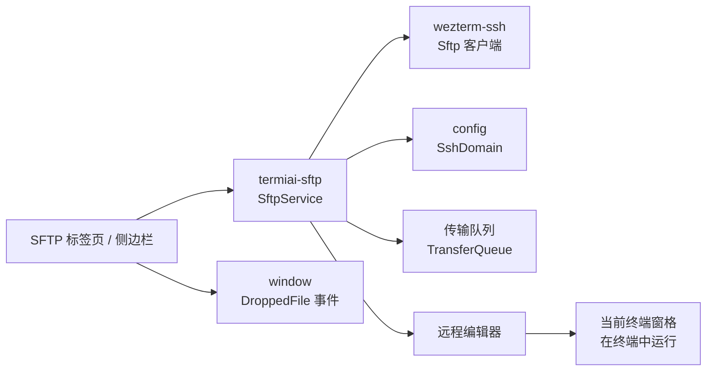

# P5 内置 SFTP

- 状态：未开始
- 依赖：P0
- 需求来源：PRD 第一部分第 4 节（内置现代化 SFTP）、第二部分第 3 节（SFTP 与终端联动）

## 1. 阶段目标

P5 把文件传输做进终端：用户可以在独立标签页或终端侧边栏浏览远程目录，复用现有 SSH 域的认证配置建立 SFTP 会话，上传下载文件，编辑远程文本文件，并把脚本直接送到当前终端执行。

阶段结束时应具备：

- 独立 SFTP 标签页与终端侧边栏两种入口。
- 复用 SSH 域配置的连接建立流程。
- 文件树、路径导航与常用文件操作。
- 带进度、速度与取消的传输队列。
- 轻量远程文本编辑与保存。
- 在终端中运行远程脚本的联动操作。

## 2. 范围

本阶段包含：

- 基于 `wezterm-ssh` 的 SFTP 会话管理。
- 文件树与传输队列界面。
- 拖入上传、拖出下载、覆盖策略与错误处理。
- 远程文本查看、编辑、保存。
- “在终端中运行”联动。
- 传输与编辑的审计记录。

本阶段不包含：

- 目录同步、断点续传与多版本冲突合并。
- 远程文件权限管理界面。
- 与 P4 批量任务结合的文件分发。
- 将 SFTP 会话与已有 SSH 窗格复用同一条 TCP 连接。

## 3. 工程设计

### 3.1 连接复用方式

`wezterm-ssh` 已经提供 SFTP 客户端，入口在 `wezterm-ssh/src/sftp/mod.rs`，底层通过 `SessionSender` 发送请求；`Session::sftp()` 会在首次操作时初始化 SFTP 子系统。[工程判断]

现有 SSH 窗格在 `mux/src/ssh.rs` 内持有自己的会话，界面层没有公开接口可以借用这条连接。P5 采用“复用域配置、新建 SFTP 会话”的方式：

- 认证方式、用户名、地址、跳板机与代理配置来自 `config/src/ssh.rs` 中的 `SshDomain`。
- 私钥与 Agent 认证不需要用户再次输入。
- 密码通过应用级内存凭据缓存复用：终端 SSH 登录成功后在现有认证回调中写入缓存，SFTP 建立会话时优先读取；缓存未命中时才提示一次，并在成功后写入。
- 缓存键使用用户名、主机、端口与认证方式的规范化组合，只在当前进程内存中存在，退出应用即清空，不写入磁盘。[工程判断]

这与 PRD 中“完美复用当前 SSH 认证信息，免去重复登录”的目标在私钥、Agent 与已登录的密码会话中都能满足；应用首次启动且只使用 SFTP 时，密码仍需输入一次。后续可以评估通过 mux 控制通道复用同一条 SSH 连接，进一步减少连接数。[待确认]

### 3.2 模块关系



`termiai-sftp` 负责会话生命周期、目录读取、传输任务与编辑器数据；界面层只消费状态与发送操作。`window` crate 已经能把拖入的文件转成 `WindowEvent::DroppedFile(Vec<PathBuf>)`，拖入上传直接复用该事件。[工程判断]

### 3.3 界面形态

两种入口共用同一套 `SftpService`：

| 形态 | 布局 | 适用场景 |
| --- | --- | --- |
| 独立标签页 | 左侧目录树，中间文件列表，底部传输队列 | 集中管理文件 |
| 终端侧边栏 | 终端右侧窄文件树，点击文件打开编辑器 | 边看日志边改配置 |

侧边栏通过分屏窗格实现，P7 再改为可折叠的浮动侧栏。侧边栏与终端共享同一个 SSH 域，但不共享同一条连接。[工程判断]

文件列表显示名称、大小、修改时间、权限与类型；目录支持懒加载，展开时才请求子目录。隐藏文件默认不显示，可通过开关切换。[工程判断]

### 3.4 传输队列

```rust
pub struct TransferTask {
    pub id: String,
    pub direction: TransferDirection,
    pub local_path: PathBuf,
    pub remote_path: String,
    pub state: TransferState,
    pub bytes_done: u64,
    pub bytes_total: Option<u64>,
    pub bytes_per_second: u64,
    pub error: Option<String>,
}
```

传输规则：

- 默认同时执行 2 个任务，可配置为 1 至 4。
- 上传先写入远程临时文件，完成后重命名，失败时删除临时文件。
- 下载先写入本地临时文件，完成后替换目标，避免半写文件。
- 同名文件默认询问，可选“覆盖”“跳过”“重命名”；选择可应用到本批次。
- 速度为滑动窗口平均值，进度以已传输字节为准；服务端不返回大小时显示不确定进度。
- 取消正在传输的任务时关闭对应句柄，已在远端的临时文件按策略清理。[工程判断]

拖入上传依赖 `WindowEvent::DroppedFile`。拖出下载需要在窗口层实现 Windows 拖放源，通过 `IDropSource` 与 `DoDragDrop` 把远程文件导出为本地临时文件后再交给资源管理器；现有 `window` crate 只处理拖入，因此这是 P5 中独立的一块窗口层工作。实现时先下载到临时目录，拖放完成后按系统行为保留或清理临时文件；下载失败时取消拖放并显示错误。[工程判断]

如果拖放源在 WinUI 3 迁移前无法稳定工作，保留“下载到…”与右键导出作为可用路径，但不把它当作拖拽下载的替代交付。[待确认]

### 3.5 远程编辑器

编辑器采用独立的文本缓冲区，不和终端窗格共享状态：

- 打开文件时读取完整内容，超过 2 MB 默认只读，提示使用下载后在本地编辑。
- 检测文件编码与换行风格，保存时保留原编码与换行。
- 保存前比较远程修改时间，发现变化时提示覆盖或取消。
- 编辑状态在标签页关闭时提示未保存内容。
- 语法高亮作为增强项，首版至少对常见配置格式（`.conf`、`.env`、`.ini`、`.yaml`、`.json`）提供基础着色；具体实现方式在开发时评估。[待确认]

编辑器快捷键沿用现有 GUI 的键位体系，避免与终端键位冲突；打开编辑器时终端输入不被转发。

### 3.6 在终端中运行

右键脚本文件选择“在终端中运行”时：

1. 确认目标终端窗格处于活动状态且没有前台全屏程序。
2. 生成 `cd <目录> && ./<文件名>` 形式的命令，路径按目标 shell 规则转义。
3. 在终端中插入命令但不自动回车，让用户确认后执行。[工程判断]
4. 如果文件没有执行权限，提示先添加权限或改用解释器运行。

不自动执行是安全边界：远程脚本可能修改生产环境，用户需要看到完整命令。[PRD] 数据传输与命令操作联动

## 4. 任务拆分

| 编号 | 任务 | 主要位置 |
| --- | --- | --- |
| P5-T01 | 建立 `termiai-sftp` crate 与会话管理 | `termiai-sftp/src/session.rs` |
| P5-T02 | 从 `SshDomain` 建立会话与内存凭据缓存 | `termiai-sftp/src/auth.rs`、`termiai-secrets/src/session_cache.rs` |
| P5-T03 | 目录读取、缓存与路径导航 | `termiai-sftp/src/tree.rs` |
| P5-T04 | 传输队列与进度事件 | `termiai-sftp/src/transfer.rs` |
| P5-T05 | 独立标签页界面 | `wezterm-gui/src/termiai/sftp_tab.rs` |
| P5-T06 | 终端侧边栏文件树 | `wezterm-gui/src/termiai/sftp_sidebar.rs` |
| P5-T07 | 拖入上传与覆盖策略 | `wezterm-gui/src/termiai/sftp_drop.rs` |
| P5-T08 | 远程文本编辑器 | `wezterm-gui/src/termiai/editor.rs` |
| P5-T09 | 在终端中运行 | `termiai-sftp/src/run.rs` |
| P5-T10 | SFTP 操作测试与错误映射 | `termiai-sftp/tests/` |
| P5-T11 | Windows 拖出下载与临时文件管理 | `window/src/os/windows/`、`wezterm-gui/src/termiai/sftp_drop.rs` |

## 5. 验收标准

- 私钥或 Agent 认证的 SSH 域可以直接建立 SFTP 会话，不需要再次输入凭据。
- 同一 SSH 域已经在终端完成密码登录后，打开 SFTP 不再次提示密码。
- 仅在缓存未命中时提示一次密码，应用运行期间再次打开 SFTP 不重复提示；退出应用后缓存清空。
- 独立标签页与侧边栏都能列出目录、进入子目录、返回上级与刷新。
- 上传、下载显示进度、速度与剩余状态，取消后任务停止，临时文件按策略清理。
- 同名文件按选择的覆盖策略处理，批量应用策略生效。
- 文本文件可以打开、修改、保存；保存后远程内容变更，换行风格保持。
- 超过 2 MB 的文件以只读方式打开并给出提示。
- 从文件列表把远程文件拖到资源管理器，能够生成下载任务并在完成后得到本地文件；取消拖放时清理临时文件。
- 右键脚本选择“在终端中运行”后，命令出现在活动终端输入行但不自动执行。
- 连接失败、权限不足、路径不存在分别显示可读错误，不显示完整凭据或服务端调试信息。

## 6. 风险与应对

| 风险 | 应对 |
| --- | --- |
| 无法复用 SSH 窗格的同一条连接 | 首期复用域配置与内存凭据缓存新建连接；私钥、Agent 与已登录密码会话无感；后续评估 mux 控制通道 |
| Windows 与 POSIX 路径语义不同 | 本地路径使用 `PathBuf`，远程路径始终使用 POSIX 字符串，拼接前做规范化 |
| 大文件传输占用内存或磁盘 | 流式读写，不把整文件载入内存；编辑器设置 2 MB 只读阈值 |
| 符号链接与权限导致目录遍历异常 | 显示链接目标，读取失败时保留已加载部分并标记错误节点 |
| 拖出下载需要新增 Windows 拖放源 | 复用现有拖入事件模型，单独实现 `IDropSource`；失败时保留导出路径并明确提示 |
| 远程编辑覆盖他人修改 | 保存前比较修改时间，冲突时要求用户选择 |
