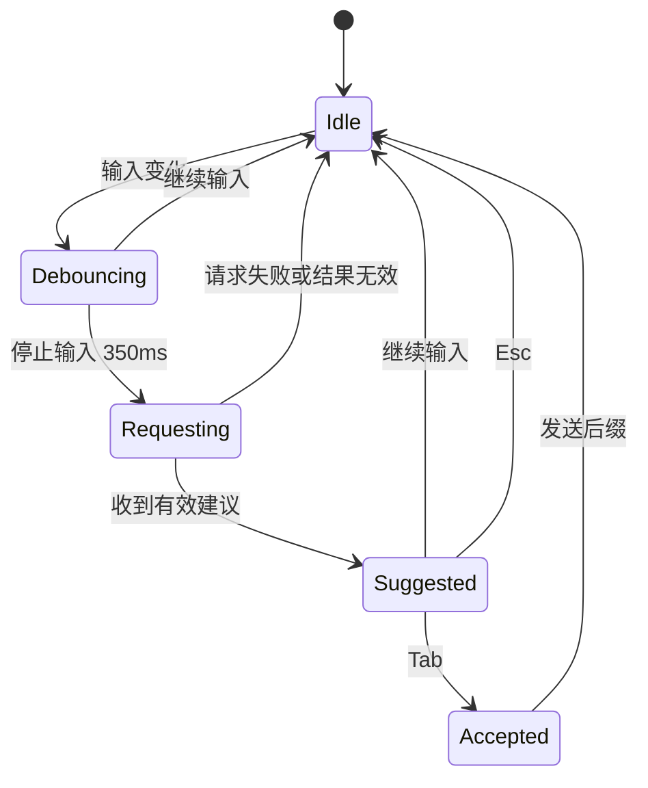

# P6 内联命令补全

- 状态：未开始
- 依赖：P1、P3
- 需求来源：PRD 第二部分第 2 节形态 A（Inline Command Suggestion）

## 1. 阶段目标

P6 在用户输入命令时，于光标后以浅灰色文本给出补全建议，按 `Tab` 采纳，继续输入则丢弃。补全只在可确认的交互式提示符下工作，不读取全量滚动缓冲区，也不在编辑器、分页器等全屏程序中触发。

阶段结束时应具备：

- 可靠的“当前输入行”读取能力。
- 防抖、取消与本地缓存的补全请求。
- 幽灵文本绘制与 `Tab` 采纳。
- 默认关闭、显式开启的隐私控制。

## 2. 范围

本阶段包含：

- 基于 OSC 133 输入区域的当前命令行读取。
- 补全请求、结果校验、缓存与取消。
- 幽灵文本渲染与键位处理。
- 开关、防抖时长与最大长度配置。
- 补全命中与采纳的本地统计，不含命令内容。

本阶段不包含：

- 行内多行补全或整段脚本生成。
- 对 shell 原生补全菜单的替换。
- 在备用屏幕程序中提供补全。
- 补全结果的自动执行。

## 3. 工程设计

### 3.1 输入行来源

不通过镜像键盘事件推测输入内容。终端在 P3 已经能标出提示符与输入区域，P6 直接读取当前输入区域的屏幕文本：

- 从 `MarkEndOfPromptAndStartOfInput` 到当前光标所在行之间的内容。
- 光标位置由终端模型提供，补全只追加在光标之后。
- 用户移动光标、删除字符或粘贴内容时，输入区域随屏幕更新，下一次请求使用最新文本。
- 没有 shell 集成或无法确定输入区域时，功能保持关闭，不做基于输出文本的猜测。[工程判断]

这要求 `Pane` 增加一个只读接口，例如 `current_input_text()`，返回文本、光标列与是否处于输入区域。实现放在 `term` 与 `mux` 的现有语义提示支持之上。[工程判断]

### 3.2 触发与取消

触发条件全部满足才发起请求：

- 功能已开启。
- 终端处于交互式输入区域，不在备用屏幕。
- 当前行长度达到 3 个字符。
- 距离上次输入停止超过防抖时间，默认 350 毫秒。
- 当前行没有命中本地排除规则。

任一新按键都会取消正在执行的请求或丢弃已完成建议。取消不等待网络返回，直接让旧请求的结果失效。[工程判断]

### 3.3 请求内容

请求只包含最小上下文：

| 字段 | 说明 |
| --- | --- |
| 当前输入行 | 最多 200 字符，超出不请求 |
| cwd | 当前工作目录 |
| shell 类型 | 来自前台进程或 shell 集成标记 |
| 操作系统 | 固定为 Windows，供模型判断命令差异 |
| 最大后缀长度 | 默认 160 字符 |

不发送滚动缓冲区、历史命令、环境变量或文件内容。模型被要求只返回可与当前行拼接的后缀，不返回解释、Markdown 或换行。[PRD] 内联补全，无侵入

### 3.4 结果校验

模型返回的后缀在展示前经过校验：

- 不含换行、回车、制表符与控制字符。
- 长度不超过配置上限。
- 不以当前行已有的完整前缀重复开头。
- 拼接后总长度不超过 400 字符。
- 不包含明显的占位符，如 `<your-key>`、`TODO`。

校验失败时丢弃建议，不展示错误提示，避免干扰输入。[工程判断]

### 3.5 幽灵文本绘制

在光标位置之后绘制建议文本，使用终端当前前景色的低透明度变体，斜体显示。建议不写入终端缓冲区，不改变光标位置，不参与选择与复制。[工程判断]

绘制位置在 `wezterm-gui/src/termwindow/render/pane.rs` 的窗格渲染流程中增加一层临时文本。只有在当前窗格获得焦点且没有其他模态面板时显示。窗口失焦、切换标签页或打开 AI 面板时清除建议。

### 3.6 采纳与发送

按 `Tab` 采纳时：

1. 把后缀通过当前窗格的写入接口发送，不使用剪贴板粘贴。
2. 发送后立即清除幽灵文本，不等待屏幕回显。
3. 如果发送失败，恢复建议并显示一次简短错误。

`Tab` 只在存在可见建议时被拦截。没有建议时，`Tab` 保持原有行为，继续交给 shell 处理原生补全。[工程判断]

用户继续输入、按 `Esc`、切换窗格或调整窗口大小时，建议立即丢弃。

### 3.7 缓存与成本控制

- 以“cwd + 当前行”为键缓存最近建议，有效期 5 分钟，仅存内存。
- 同一前缀命中缓存时不发起请求。
- 每次采纳后清除该前缀的缓存，避免重复建议已输入的内容。
- 连续请求失败三次后暂停该会话的自动请求 1 分钟，界面不弹窗，只在设置中显示状态。[工程判断]

### 3.8 隐私控制

补全需要连续读取用户输入，默认关闭。开启时在设置中明确说明“当前输入行会发送到你配置的模型服务”，并要求用户主动勾选。[PRD] 数据安全

本地排除规则至少覆盖：

- 含 `password`、`passwd`、`token`、`secret`、`api_key`、`apikey` 的输入行。
- 以 `export` 开头且包含 `=` 的输入行。
- 用户自定义的正则列表。

排除规则只做字符串匹配，不能保证识别所有敏感内容；设置页需要说明这一限制。[工程判断]

## 4. 任务拆分

| 编号 | 任务 | 主要位置 |
| --- | --- | --- |
| P6-T01 | 暴露当前输入区域文本与光标位置 | `term/src/terminalstate/`、`mux/src/pane.rs` |
| P6-T02 | 补全配置与排除规则 | `config/src/config.rs` |
| P6-T03 | 补全请求、校验与缓存 | `termiai-ai/src/complete.rs` |
| P6-T04 | 防抖、取消与失败退避 | `wezterm-gui/src/termiai/completion.rs` |
| P6-T05 | 幽灵文本绘制 | `wezterm-gui/src/termwindow/render/pane.rs` |
| P6-T06 | `Tab` 采纳与 `Esc` 丢弃 | `wezterm-gui/src/inputmap.rs`、`termwindow/mod.rs` |
| P6-T07 | 设置项与隐私说明 | P1 设置面板扩展 |
| P6-T08 | 输入区域与补全流程测试 | `term/src/test/`、`termiai-ai/tests/` |

## 5. 验收标准

- 开启功能后，在启用 shell 集成的 PowerShell、bash、zsh 中输入命令并停顿，光标后出现灰色建议。
- 建议出现后继续输入、按 `Esc`、切换窗格或调整窗口，建议在 100 毫秒内消失。
- 按 `Tab` 后建议文本进入命令行，光标位置正确，未触发 shell 原生补全。
- 没有建议时按 `Tab`，shell 原生补全行为不变。
- 在 `vim`、`less` 等备用屏幕程序中不出现建议，也不发请求。
- 关闭功能后没有任何补全请求；开启但未同意隐私说明时同样不发请求。
- 当前行超过 200 字符、命中排除规则或包含控制字符时不发请求。
- 模型返回多行内容、Markdown 或超长文本时建议被丢弃，输入不受影响。
- 请求失败不阻塞输入，连续失败后暂停请求，终端仍可正常使用。

## 6. 风险与应对

| 风险 | 应对 |
| --- | --- |
| 与 shell 原生 `Tab` 补全冲突 | 只在建议可见时拦截 `Tab`；无建议时完全透传 |
| 输入法组合输入期间触发请求 | 组合输入未提交时不请求，提交后再启动防抖 |
| 远程会话延迟高，建议过时 | 每次按键取消旧请求；缓存前缀结果；不追求逐键实时 |
| 连续请求带来费用与隐私风险 | 默认关闭；防抖与缓存；失败退避；排除明显敏感输入 |
| 多行编辑或光标位于行中间 | 只支持在光标后追加，跨行或多光标场景直接不提供建议 |
| 模型返回不可执行内容 | 严格校验后缀，失败静默丢弃 |
