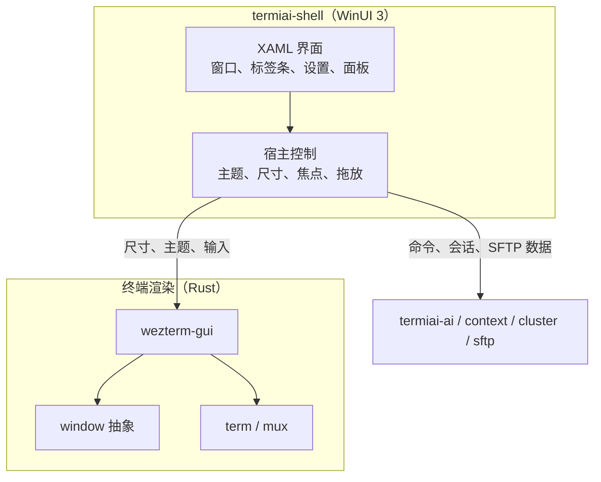
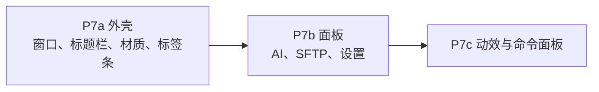

# P7 WinUI 3 视觉宿主

- 状态：未开始
- 依赖：P0 的宿主验证结论、P2、P5
- 需求来源：PRD 第一部分第 2 节（WinUI 3 视觉与动效）、第二部分第 2 节与第 3 节的界面形态

## 1. 阶段目标

P7 把当前 Win32 窗口与上游风格界面，替换为 WinUI 3 视觉宿主：Mica 与 Acrylic 材质、无边框圆角窗口、Fluent 动效，以及统一的命令面板与设置中心。终端渲染核心继续使用现有 Rust 实现，不重写终端模型。

阶段结束时应具备：

- WinUI 3 应用外壳与终端渲染表面的稳定组合。
- Windows 11 的 Mica/Acrylic 与 Windows 10 的可用回退。
- 无边框圆角窗口、自定义标题栏与系统贴靠行为。
- 标签页切换、侧边栏展开/收起的弹簧动效。
- 命令面板覆盖快捷键、AI 指令、SSH 会话与 SFTP 路径。
- AI 面板、SFTP 侧栏与设置中心的统一视觉。

## 2. 范围

本阶段包含：

- 宿主路线落地与窗口生命周期。
- 材质、圆角、标题栏、主题与 DPI。
- 现有界面的迁移顺序与回退策略。
- 动效、命令面板扩展与设置中心。
- 打包与运行时依赖。

本阶段不包含：

- 重写终端仿真、字体渲染或多路复用。
- 更换 AI 协议或上下文模型。
- 新增 PRD 之外的业务功能。

## 3. 工程设计

### 3.1 宿主路线

P0 的验证会在三条路线中给出结论。P7 按结论执行，不在本阶段重新选型：

| 结论 | P7 做法 | 影响 |
| --- | --- | --- |
| A. 外壳加子窗口 | WinUI 3 负责窗口、标签条、设置与面板，终端 Surface 作为子窗口嵌入 | 终端渲染几乎不改，重点是窗口层级与输入焦点 |
| B. SwapChainPanel | 为 `window` crate 增加 WinUI 3 渲染后端，终端画面直接进入 XAML 合成 | 视觉一体化最好，但需要重写交换链与输入循环 |
| C. 仅设置用 WinUI 3 | 主窗口维持 Win32，设置与关于使用 WinUI 3 | 不满足 Mica 主窗口目标，需要产品层面确认降级 |

路线 A 的可行性最高，也最容易保持上游合并能力：窗口层做适配，渲染层不动。[工程判断] 路线 B 只有在 A 无法满足输入延迟与材质要求时才采用。

### 3.2 进程与模块关系

宿主与渲染之间需要一份稳定契约，至少包含：

- 窗口尺寸、缩放因子、可见性。
- 主题变化：亮暗模式、强调色、材质可用性。
- 焦点与输入法状态。
- 标签页与会话标识。
- 面板开关与尺寸。
- 拖入文件事件。

如果采用同进程嵌入，契约通过 Rust 与 C++/WinRT 或 C# 的互操作层传递；如果采用双进程，契约通过本地 IPC 传递。进程模型在 P0 验证时一并确定，P7 只实现已选方案。[待确认]

### 3.3 视觉系统

| 元素 | 设计 | 依据 |
| --- | --- | --- |
| 窗口背景 | Windows 11 使用 Mica；Windows 10 使用 Acrylic，不支持时回退为纯色 | [PRD] 材质要求 |
| 窗口边框 | 无边框，自定义标题栏，保留系统贴靠、最大最小化与关闭 | [PRD] 极简无边框 |
| 圆角 | 窗口与面板使用系统圆角半径，内部卡片使用统一半径变量 | [PRD] 圆角窗口 |
| 主题 | 跟随系统亮暗模式与强调色，保留手动覆盖 | [PRD] 跟随系统 |
| 字体 | 界面使用系统 UI 字体，终端字体继续由现有配置控制 | [工程判断] 不改变终端排版 |
| 动效 | 标签切换、侧栏展开使用弹簧阻尼；尊重系统“减少动画”设置 | [PRD] Fluent 动效 |

材质与终端画面的组合是最大不确定点。Mica 是窗口背景材质，终端画面如果是不透明 Surface，材质只能出现在未覆盖区域。设计上把标签条、侧栏与面板做成半透明层，终端区域保持可配置的不透明度，用户可以选择“终端背景跟随主题”或“终端使用自身配色”。[工程判断]

### 3.4 迁移顺序

P7 分三步落地，每一步都可以独立验收：

P7a 只替换窗口外壳，终端内容与现有交互保持不变。验收重点是输入延迟、DPI、输入法、贴靠与材质。

P7b 把 P2 的 AI 面板、P5 的 SFTP 侧栏和 P1 的设置面板迁移到 WinUI 3。迁移时业务状态仍由 Rust 模块持有，XAML 只做展示与命令转发，避免逻辑出现两份。[工程判断]

P7c 加入弹簧动效与命令面板改版。动效只作用于标签切换、侧栏与面板，不对终端内容做缩放或淡入，避免影响阅读与输入。[工程判断]

### 3.5 命令面板

现有命令面板在 `wezterm-gui/src/termwindow/palette.rs`，已经支持模糊搜索与命令执行。P7 扩展为统一入口：

| 来源 | 内容 | 提供方 |
| --- | --- | --- |
| 快捷键与内置命令 | 现有命令列表 | `wezterm-gui/src/commands.rs` |
| AI 指令 | 打开面板、诊断最近错误、解释选中文本、切换 AI 服务商 | `termiai-ai` 与界面层 |
| SSH 会话 | 已保存的域与最近会话 | `config` 与 `mux` |
| SFTP 路径 | 最近访问目录与常用远程路径 | `termiai-sftp` |

搜索与排序逻辑集中在一处，XAML 只负责绘制。命令面板的键盘导航与终端焦点切换需要避免与终端快捷键冲突；打开面板时暂停终端输入转发。[工程判断]

### 3.6 设置中心

设置中心用 WinUI 3 实现，分为终端、AI、SFTP、外观与隐私五组。AI 与 SFTP 的设置项复用 P1、P5 已有的配置读写与密钥存储，不新增另一套存储。

保存策略：

- 外观与终端设置即时生效。
- AI 服务商切换与密钥修改在保存后生效，正在生成的回答不中断。
- 配置校验失败时定位到具体字段，阻止关闭设置页并提示未保存。[工程判断]

### 3.7 打包与运行

WinUI 3 依赖 Windows App SDK。需要在 P7 开始前确定：

- 使用 MSIX 打包还是非打包运行。
- Windows App SDK 运行时是随应用分发还是要求系统预装。
- 自动更新通道是否在 P7 建立，或继续留待后续。

PRD 没有规定分发方式，本阶段默认采用非打包运行加运行时安装检测，保证开发与内测阶段的启动成功率；正式发布前再评估 MSIX。[待确认]

## 4. 任务拆分

| 编号 | 任务 | 产出 |
| --- | --- | --- |
| P7-T01 | 建立 `termiai-shell` 工程与宿主契约 | 可启动的 WinUI 3 窗口与渲染表面 |
| P7-T02 | 窗口生命周期、主题、DPI 与贴靠 | 无边框圆角窗口与系统行为 |
| P7-T03 | 标签条与右侧面板容器 | 标签切换、侧栏展开 |
| P7-T04 | 迁移 AI 面板 | 浮动 AI 面板与流式输出 |
| P7-T05 | 迁移 SFTP 侧栏与标签页 | 文件树、传输队列、编辑器入口 |
| P7-T06 | 迁移设置中心 | 五组设置与保存校验 |
| P7-T07 | 命令面板统一搜索 | 快捷键、AI、会话与 SFTP 路径 |
| P7-T08 | 动效与无障碍设置 | 弹簧动效、减少动画、键盘导航 |
| P7-T09 | 打包与运行时检测 | 启动前依赖检查与错误提示 |
| P7-T10 | 性能与输入回归测试 | 与 P0 基线对比的延迟报告 |

## 5. 验收标准

- Windows 11 上窗口显示 Mica 或 Acrylic；Windows 10 上回退生效，无黑底与闪烁。
- 无边框窗口保留贴靠布局、最大最小化、关闭与双击标题栏行为。
- 100%、150%、200% 缩放下终端网格与界面文字清晰，窗口拖动跨屏时正确重绘。
- 微软拼音输入法的候选框定位正确，终端输入法模式切换不丢失字符。
- 标签切换与侧栏展开动效流畅；开启“减少动画”后动效消失但功能正常。
- 键盘输入到画面反馈的延迟不高于 P0 基线的中位数加 16 毫秒。
- AI 面板、SFTP 侧栏与设置中心在 WinUI 3 中可完成 P2、P5、P1 的全部验收操作。
- 命令面板能搜索并执行内置命令、AI 指令、SSH 会话与 SFTP 路径，键盘导航不触发终端输入。
- 未安装 Windows App SDK 时，启动给出明确安装指引，不出现无提示崩溃。
- 上游合并后，终端渲染与 mux 相关测试仍通过，新增宿主工程不进入上游构建路径。

## 6. 风险与应对

| 风险 | 应对 |
| --- | --- |
| 宿主与 OpenGL 表面组合不稳定 | P0 提前验证；路线 A 失败时切换 B 或降级 C |
| 输入延迟或输入法问题 | 每步迁移后做固定脚本的延迟与输入法回归，不通过就不进入下一步 |
| 材质导致终端可读性下降 | 终端背景不透明度可配置，默认保持可读；材质只作用于外壳与面板 |
| WinUI 3 与 Rust 互操作复杂 | 把契约收敛到窗口、主题、输入三组数据，业务数据通过现有模块接口传递 |
| 双份界面逻辑 | 业务状态留在 Rust，XAML 只做视图与命令转发，代码评审检查重复实现 |
| 打包与运行时依赖影响启动 | 启动前检测并给出安装指引；内测阶段优先保证可启动 |
| 上游窗口层改动导致冲突 | 宿主工程独立，尽量通过现有 `window` 抽象接入，减少直接修改上游文件 |
