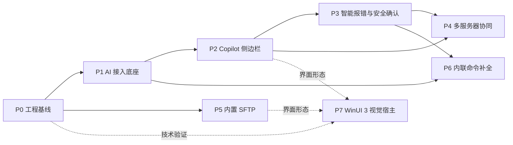
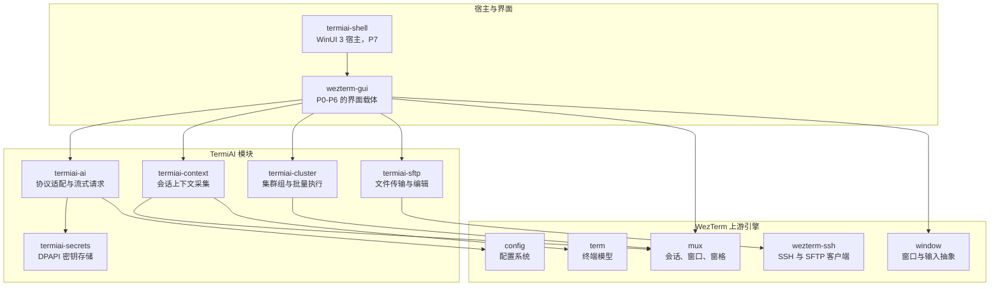

# TermiAI 功能开发文档

- 文档版本：v0.1
- 更新日期：2026-10-23
- 上游文档：[TermiAI 产品需求文档（PRD）](<../TermiAI 产品需求文档 (PRD).md>)
- 当前阶段：P0 尚未开始

本目录把 PRD 中的产品需求拆成按依赖顺序推进的开发阶段。PRD 回答“做什么”，这里回答“先做哪一块、模块边界在哪、每个阶段怎样算完成”。具体实现以代码和评审结论为准。

## 当前基线

仓库目前是 WezTerm 的干净 fork，没有 TermiAI 自有代码。终端渲染、多路复用、SSH 与 SFTP 底层已经可用，但 PRD 中的 AI 能力、WinUI 3 宿主与内置 SFTP 界面都还没有开始实现。

| 能力 | 现状 | 来源 |
| --- | --- | --- |
| GPU 终端渲染、标签与分屏 | 可用 | 上游 WezTerm |
| SSH 远程会话、跳板机与代理 | 可用 | 上游 `wezterm-ssh`、`mux` |
| SFTP 协议客户端 | 可用，无产品界面 | 上游 `wezterm-ssh/src/sftp` |
| 命令面板与启动器 | 可用，未接入 AI 指令 | 上游 `wezterm-gui` |
| OSC 133 语义提示解析 | 部分可用，退出码被忽略 | 上游 `term` |
| AI 接入、上下文采集 | 未开始 | 本项目建设 |
| WinUI 3 视觉宿主 | 未开始 | 本项目建设 |

## 阶段路线

| 阶段 | 目标 | 主要交付 | 依赖 | 状态 |
| --- | --- | --- | --- | --- |
| [P0](P0-工程基线与WinUI3技术验证.md) | 建立可持续开发的工程基线 | Windows CI、品牌化策略、模块边界、日志脱敏、WinUI 3 技术验证 | 无 | 未开始 |
| [P1](P1-AI接入底座.md) | 打通 AI 服务接入 | 双协议客户端、配置模型、DPAPI 密钥存储、设置面板、连通性测试 | P0 | 未开始 |
| [P2](P2-Copilot侧边栏与单会话上下文.md) | 让 AI 能看见单个会话 | Copilot 面板、`@` 会话选择、上下文采集与预览、流式回答 | P1 | 未开始 |
| [P3](P3-智能报错捕获与安全确认.md) | 把报错转成可执行的修复建议 | 退出码采集、报错上下文捕获、修复建议卡片、高危命令确认 | P1、P2 | 未开始 |
| [P4](P4-多服务器集群协同.md) | 让 AI 跨多台服务器工作 | 集群组、批量计划与预览、受控执行、汇总报告 | P2、P3 | 未开始 |
| [P5](P5-内置SFTP.md) | 把文件传输做进终端 | 独立 SFTP 标签页、侧边栏文件树、传输队列、远程编辑、在终端运行 | P0 | 未开始 |
| [P6](P6-内联命令补全.md) | 在输入行内给出补全 | 输入行跟踪、防抖请求、幽灵文本、Tab 采纳 | P1、P3 | 未开始 |
| [P7](P7-WinUI3视觉宿主.md) | 换用 WinUI 3 视觉宿主 | Mica/Acrylic、无边框圆角窗口、动效、命令面板改版、设置中心 | P0 验证结论、P2、P5 | 未开始 |

图中实线表示功能依赖，虚线表示 P7 需要复用前序阶段的交互与界面结构。P5 与 P2、P3 之间没有代码依赖，P0 完成后可以由另一条开发线并行推进；P6 需要 P3 提供的语义提示状态，否则无法可靠判断“当前是否在输入行”。

## 目标架构

各模块的职责边界：

- `termiai-ai` 只负责把统一的聊天请求转换成 OpenAI 或 Anthropic 协议，并把流式响应转成内部事件。它不知道终端、窗格或界面的存在。
- `termiai-context` 只负责从 `mux` 与 `term` 读取会话上下文，做裁剪、标记来源和估算体积。它不发起网络请求。
- `termiai-secrets` 只负责 Windows DPAPI 加解密和本地文件读写，不关心密钥属于哪个服务。
- `termiai-cluster` 负责集群组模型、批量计划、执行顺序与结果汇总，通过 `mux` 的窗格接口发送命令。
- `termiai-sftp` 负责文件树、传输队列与远程编辑，底层调用 `wezterm-ssh` 的 SFTP API。
- 界面层负责把上述模块的事件画出来、把用户操作转成调用；AI 逻辑不直接写在 `wezterm-gui` 的渲染代码里。

## 与上游代码合并的策略

这个项目需要持续合并 WezTerm 上游更新，因此改动范围要克制。

| 决策 | 内容 | 依据 |
| --- | --- | --- |
| 不改上游 crate 名称 | `term`、`mux`、`wezterm-gui` 等保持原名，品牌化放在可执行文件、安装包与资源层 | [工程判断] 重命名会制造大量无意义冲突，收益只在命名一致性 |
| 新能力放进新 crate | 统一使用 `termiai-` 前缀，通过少量公开接口接入上游 | [工程判断] 便于独立测试，也便于上游同步时定位冲突 |
| 上游文件只加最小钩子 | 允许修改 `config`、`term`、`mux`、`wezterm-gui` 的少量接入点，改动集中并写注释说明用途 | [工程判断] 完全不改上游无法实现退出码、面板与配置 |
| 品牌化分层推进 | P0 先处理窗口标题、图标、安装包与关于信息，不急于改二进制名 | [工程判断] 内部改名不影响用户感知，却能显著增加合并成本 |

需要在上游文件中增加的钩子预计集中在以下位置：

| 位置 | 用途 | 引入阶段 |
| --- | --- | --- |
| `config/src/config.rs` | 增加 `termiai` 配置命名空间与嵌套结构 | P0、P1 |
| `term/src/terminalstate/performer.rs` | 记录 OSC 133 的命令状态与命令文本 | P3 |
| `mux/src/pane.rs` | 暴露最近命令结果、上下文文本读取的稳定接口 | P3 |
| `wezterm-gui/src/termwindow/palette.rs`、`commands.rs` | 命令面板增加 AI 指令与会话入口 | P1、P2 |
| `wezterm-gui/src/overlay/` | 设置面板、确认卡片、AI 面板 | P1、P2、P3 |
| `wezterm-gui/src/termwindow/render/pane.rs` | 幽灵文本绘制 | P6 |

## 跨阶段工程约定

- 配置统一放在 `config.termiai` 命名空间下，避免与上游字段混在一起；密钥不进入 Lua 配置，单独存放在 `%LOCALAPPDATA%\TermiAI\secrets.bin` 这类本地文件中。[工程判断]
- 所有对外请求默认超时 60 秒，可配置；单次请求必须支持取消。超时与取消都要映射成明确的错误类型，界面据此显示不同提示。[工程判断]
- 日志中禁止出现 API Key、SSH 密码、完整请求体。请求日志只记录服务商、模型、耗时、token 用量与错误码。[PRD] 数据安全要求
- AI 功能默认不发送任何终端内容。每次发送前，界面必须展示本次会带上的上下文范围，并由用户主动触发。[PRD] Copilot 交互与数据安全要求
- 新增 crate 必须有单元测试；涉及配置、协议解析、风险命令判定的逻辑不依赖真实网络。端到端测试放在 `wezterm-ssh/tests` 同类的位置。[工程判断]
- 每个阶段结束时，文档中的验收标准要能在 Windows 10 与 Windows 11 上复现；不能只在开发机上通过。[PRD] 目标平台

## 风险总览

| 风险 | 影响 | 应对 | 涉及阶段 |
| --- | --- | --- | --- |
| WinUI 3 与现有 OpenGL 渲染表面难以稳定合成 | P7 可能无法按 PRD 形态落地 | P0 先做带指标的技术验证，保留“仅用 WinUI 3 做设置与外壳”的降级方案 | P0、P7 |
| shell 集成覆盖不足导致退出码与输入状态缺失 | P3、P6 在部分 shell 上不可用 | 先支持 PowerShell、bash、zsh，缺失集成时禁用相关功能而不是猜测 | P3、P6 |
| 上游合并冲突持续累积 | 版本跟进成本上升 | 新代码放独立 crate，上游文件只做集中钩子，固定节奏合并 | 全阶段 |
| AI 误判导致高危命令被执行 | 生产事故 | 规则判定优先于模型判断，执行前强制人工确认，默认只提供复制不自动运行 | P3、P4 |
| 连续补全请求泄露输入内容 | 隐私风险 | 默认关闭，显式开启后才发送当前输入行，不做后台全量采集 | P6 |
| SFTP 无法直接复用已建立的 SSH 连接 | 需要重复认证 | 首期复用域配置新建 SFTP 会话，密码在内存中复用；后续再评估复用同一连接的通道 | P5 |

## 文档索引

| 文档 | 内容 |
| --- | --- |
| [P0 工程基线与 WinUI 3 技术验证](P0-工程基线与WinUI3技术验证.md) | CI、模块边界、品牌化、日志脱敏、宿主方案验证 |
| [P1 AI 接入底座](P1-AI接入底座.md) | 双协议客户端、配置、DPAPI、设置面板、连通性测试 |
| [P2 Copilot 侧边栏与单会话上下文](P2-Copilot侧边栏与单会话上下文.md) | AI 面板、`@` 会话、上下文采集与预览、流式输出 |
| [P3 智能报错捕获与安全确认](P3-智能报错捕获与安全确认.md) | 退出码、报错上下文、修复建议、高危命令确认 |
| [P4 多服务器集群协同](P4-多服务器集群协同.md) | 集群组、批量计划、执行与汇总 |
| [P5 内置 SFTP](P5-内置SFTP.md) | 双模态界面、传输队列、远程编辑、终端联动 |
| [P6 内联命令补全](P6-内联命令补全.md) | 输入行跟踪、幽灵文本、采纳与隐私控制 |
| [P7 WinUI 3 视觉宿主](P7-WinUI3视觉宿主.md) | 材质、圆角窗口、动效、命令面板与设置中心 |
